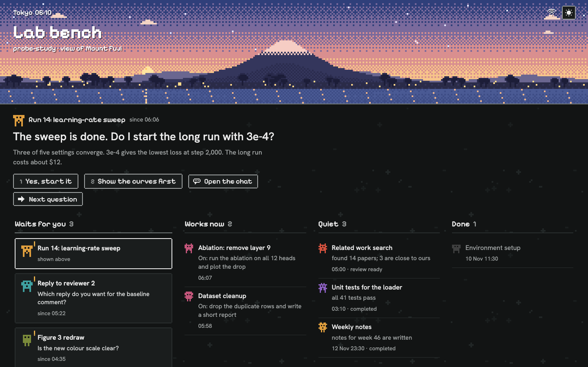
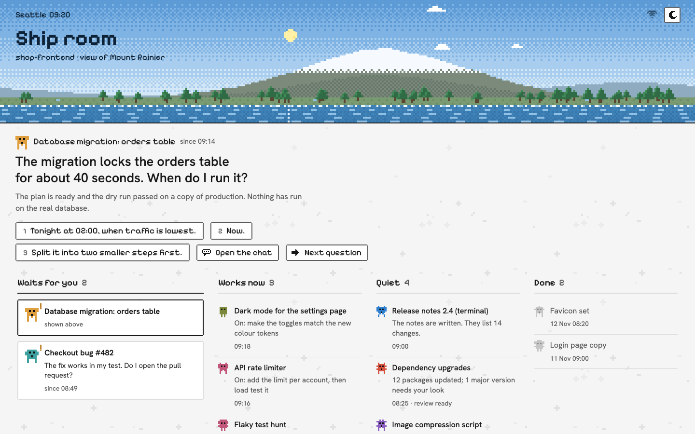
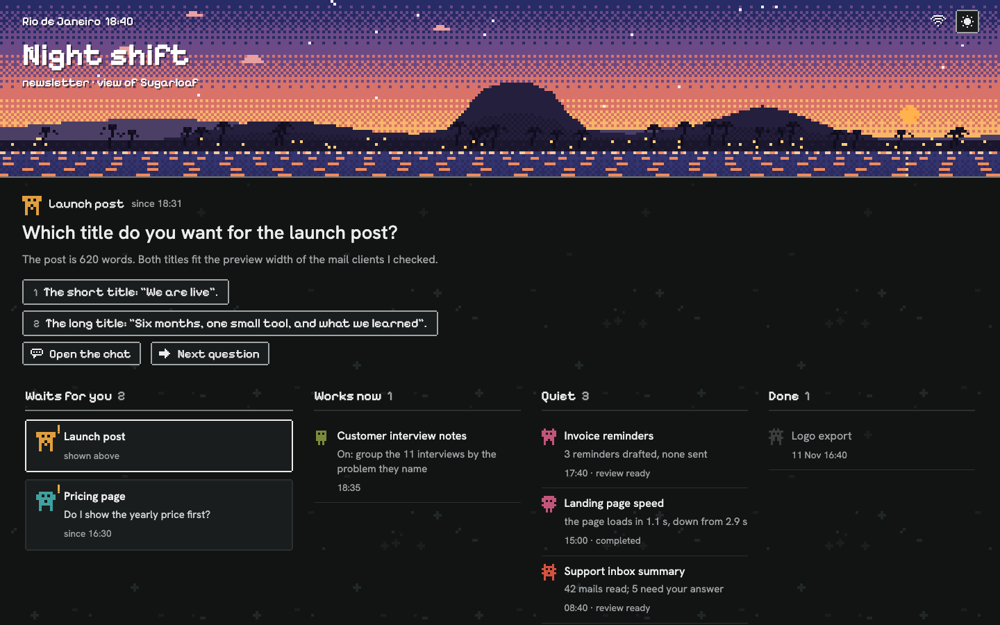
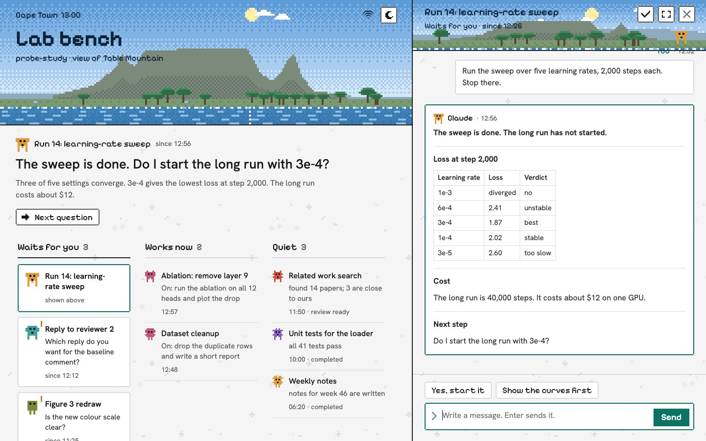
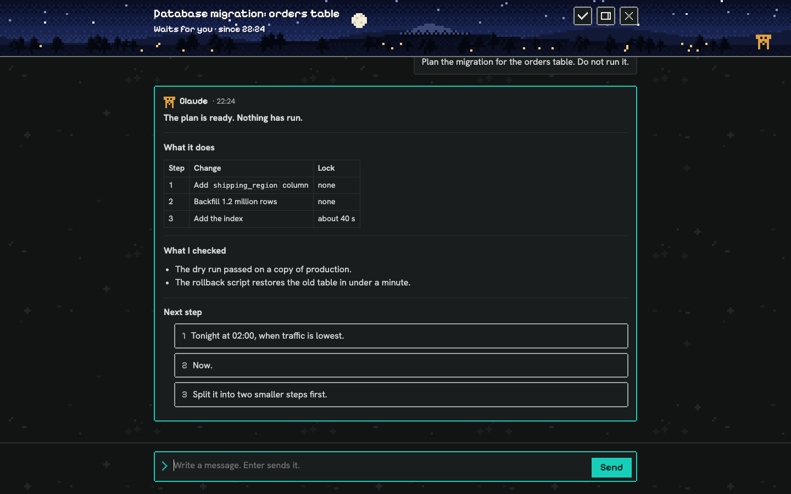
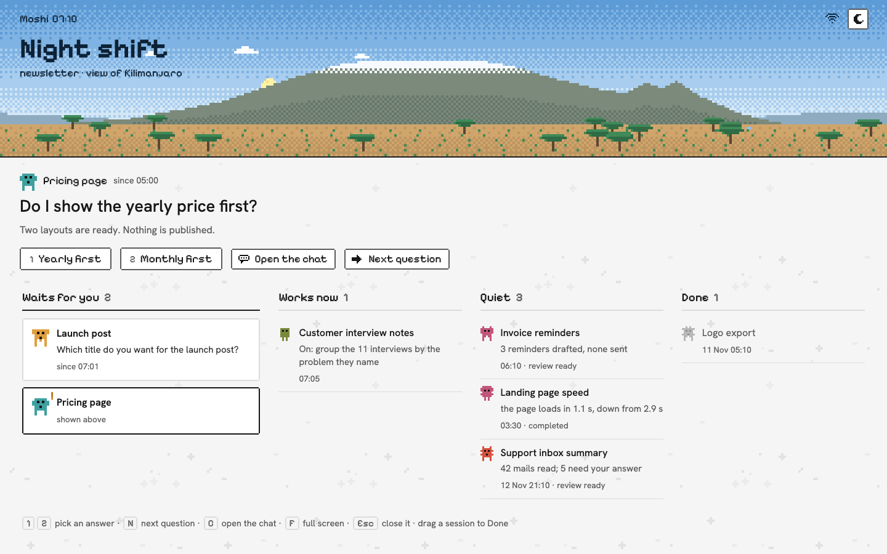
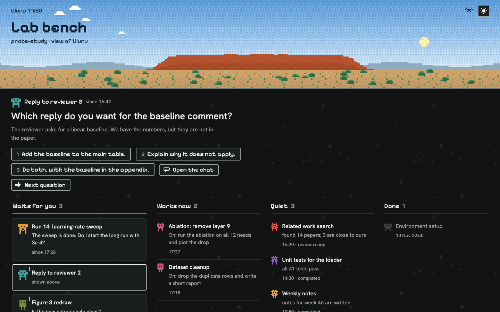
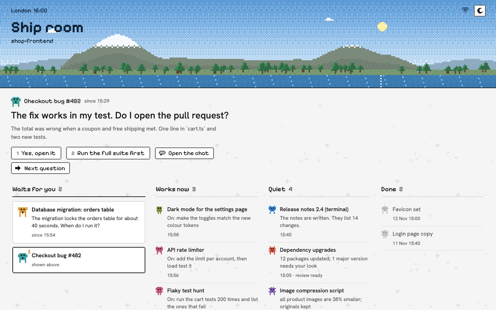
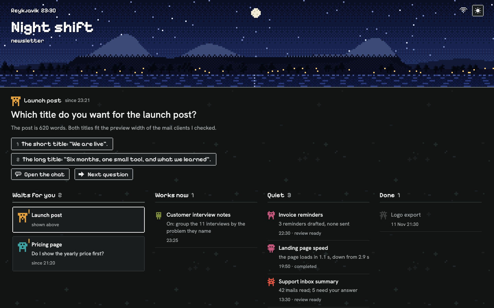

# Session board

A local dashboard for all of your Claude Code sessions in the Claude desktop app.

This is a small tool for people who run a _lot_ of Claude Code sessions at the same time, and lose track of them. It reads the sessions on your machine and gives you one page: which sessions are waiting for you, which are working, and a chat for each one, so you can answer all of them from one place.

It also looks like a small pixel game, with a view of a mountain near you. I look at this page for a large part of my day, so I wanted it to be a nice thing to look at.



**TL;DR**

* Your sessions are sorted into four columns: Waits for you, Works now, Quiet, Done
* The question that a session is asking you sits at the top of the page, with its answers as buttons
* Each session has a chat, as a side panel or in full screen. What you type is sent to that session
* It runs on your machine only. Nothing about your sessions leaves it
* It is unofficial, and it is built on files that the desktop app writes for itself. I expect it to break when the app changes. See [Limitations](#limitations) before you rely on it

## Quick start

### Install

You need Node 20 or later, and the Claude desktop app.

```shell
git clone https://github.com/brend0nc/session-board
cd session-board
npm install
npm link
```

`npm install` also builds the app, and `npm link` puts the `session-board` command on your path.

### Use

```shell
session-board init
session-board
```

`init` asks you for a name for your board, your own name, and (optionally) one project to show. Then open http://127.0.0.1:4748.

At this point you can _read_ all of your sessions. To _answer_ them from the board, you need the relay.

### Start the relay

This is the one fiddly part, and it is worth understanding why it exists. A web page has no way to type into a Claude session. But a Claude session can send a message to another session. So the board puts your message in a queue, and a small Claude session (the relay) picks it up and passes it on, word for word.

```shell
session-board relay
```

This opens the Claude desktop app at a new Code session, with the relay prompt already in the box. Press Enter there, and the relay runs. (`session-board init` offers to do this for you at the end.) A small, fast model is enough for it.

The wifi icon at the top of the board tells you if the relay is on. If the relay is off, the icon turns into a **Start the relay** button that does the same thing. So after you restart the app, it is one click and one Enter to get the relay back, and your messages wait in the queue in the meantime.

I could not make this fully automatic. The app will fill in a prompt from a link, but (sensibly) it will not send it for you. If the link does not work on your system, `session-board relay-prompt` prints the prompt, so you can paste it by hand.

## What you get

* **One question at a time.** The top of the page shows a single question from a single session, with the session's own answers as buttons. Press `N` for the next one. This was the feature I wanted most: with ten sessions open, the hard part is to find the one that has been stuck on me for two hours
* A chat for each session, with the full recent conversation. If a reply ends in a numbered list of options, each option becomes a button
* Links between sessions work. If one session mentions another one, you can click through to its chat
* A Done column that is yours. Drag a session there when you are finished with it. It comes back by itself if the session asks you something again, so you cannot lose a question by tidying up
* A small creature for each session, generated from the session's id. It walks while the session is working. This is not useful, but I like it
* Keyboard shortcuts: `1` `2` pick an answer, `N` next question, `C` open the chat, `F` full screen, `Esc` close

## The view

The top of the page is a pixel-art view that tries to match where you are and what time it is.

* If you press **Find my mountain** and allow the location, the board picks the closest mountain from a catalog of 32 skylines, within 350 km. Some of the ones in there: Table Mountain, Mount Fuji, Mount Rainier, the Matterhorn, Kilimanjaro, Sugarloaf, Uluru
* If nothing in the catalog is near you, you get a made-up range in the style of your latitude (palms near the equator, pines and snow far from it)
* The sky follows dawn, day, dusk and night in your time zone. The trees lean in the wind, the sea has waves, and a lake shows the mountain
* The mountain keeps its shape, but the far hills, the clouds and the trees are different each day
* Each session that is working right now is a small light on the shore

To be clear, the skylines are rough outlines made by hand, and I have only checked the one I can see from my own window. If your local mountain looks wrong, or is missing, please fix it in `web/mountains.ts` and send a PR! Each one is a single line of `x,height` pairs.

You can try any of them without changing your settings: add `?view=fuji` or `?at=07:30` to the address.

You can also look at the board before you have any sessions of your own: `?demo=webdev`, `?demo=research` and `?demo=founder` show it with sample sessions. In a demo nothing is read and nothing is sent, so you can click around and answer the sample questions.

## Gallery

What the board looks like for different people, places and times of day. All of these use the sample sessions of the demo mode, so there is no real work in them.

| | |
|---|---|
|  Seattle at 09:20, Mount Rainier |  Rio de Janeiro at dusk, Sugarloaf |
|  Cape Town at 13:00, with a chat open as a side panel |  Zermatt at night, with the chat in full screen |
|  Moshi at 07:10, Kilimanjaro |  Uluru in the late afternoon |
|  London has no mountain in the catalog, so it gets made-up hills |  Reykjavik at night, with a made-up range in the far north style |

Every picture comes from an address like `?demo=research&view=fuji&at=06:10&theme=night`, so you can make your own.

## Limitations

I want to be upfront about what this is. I built it in one evening with Claude Code, for my own use, and it has only ever run on my own Mac.

* **It reads files that are not a public interface.** The board works by reading the session files of the Claude desktop app and the ends of the Claude Code transcripts. Nobody promised that these stay the same. When they change, the board may show wrong states, or no sessions at all
* A session sees your board message as a message from the relay session, with your name in front of it. In my experience sessions act on it, but a careful session may ask you to confirm in its own window before it spends money. I think that is the right behaviour
* The relay is a Claude session, so each message you send costs a few tokens there. With a small model this has been negligible for me
* Sessions that you started in a terminal show up on the board, but you cannot message them
* It is only tested on macOS. The code has paths for Windows and Linux, but nobody has run them
* The two fonts load from Google Fonts. Without internet you get system fonts, and everything else still works

## How it works

* The server (`session-board`) listens on `127.0.0.1` only. On each refresh it reads the desktop app's session files and the last few megabytes of each transcript
* A session is in "Waits for you" if its last turn ended with a question, and in "Works now" while a turn is open
* A message you send goes into `~/.session-board/data/outbox.jsonl`. The relay session runs `session-board wait`, which blocks until a message is queued. It then sends the message with the desktop app's `send_message` tool and marks it as sent
* Only one relay runs at a time. If you start a second one by accident, it sees the first and stops
* Every request that changes something needs a token, which the board makes on first start. Your place is kept to two decimals in your settings file and is sent nowhere

## Settings

Everything is in `~/.session-board/config.json`, and every key is optional. You can also rename the board on the page: point at its name and press the pencil.

| Key | Meaning | Default |
|---|---|---|
| `title` | Name of your board | `Sessions` |
| `project` | Part of a folder path. Only sessions in a matching folder are shown | all projects |
| `name` | Your name, shown to a session with each message | your user name |
| `city` | Label next to the clock | from the mountain or the time zone |
| `time_zone` | For example `Europe/London` | your computer's time zone |
| `lat`, `lon` | Your place | set by **Find my mountain** |
| `skyline` | `auto`, `random`, or the name of one mountain | `auto` |
| `port` | Port of the page | `4748` |
| `days` | Hide sessions that were quiet for this many days | `10` |

## Advice for reading the code

The code is small (about 2,500 lines of TypeScript, with no runtime dependencies), and it is split by job:

* `src/sessions.ts` is the part that reads the app's files. If the board breaks after an app update, the fix is almost certainly here
* `src/relay.ts` has the relay loop and the relay prompt
* `src/server.ts`, `src/store.ts` and `src/cli.ts` are the page server, the message queue and the commands
* `web/app.ts` is the page itself
* `web/scene.ts` draws the view, cell by cell, and `web/mountains.ts` is the catalog

Run `npm run build` after a change.

## Why I built this

I work on a research project where I often have ten or more Claude Code sessions open at once: one runs an experiment, one reviews a result, one writes a draft. It works well, right up to the point where I forget that a session exists. I kept finding sessions that had asked me a yes or no question hours earlier and then sat there, while I was busy in another window.

**This tool is my attempt to fix that**: one place that tells me who is waiting for me, and lets me answer without a hunt for the right window. If you run many sessions too, I hope it is useful to you. If you have ideas, find a bug, or want your mountain in the catalog, please open an issue!

## License

MIT. See [LICENSE](LICENSE).
